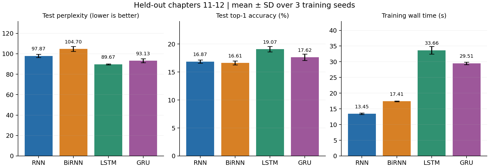
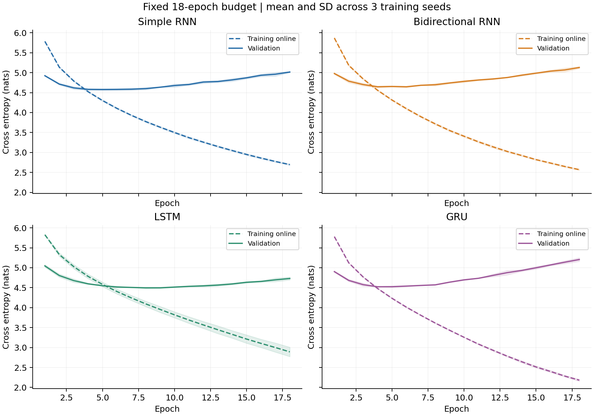
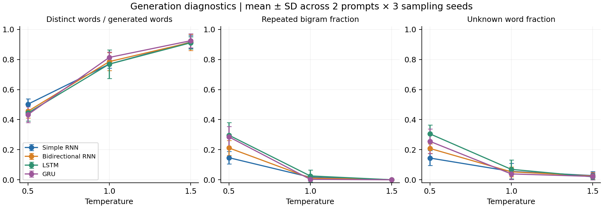

# Autoregressive next-word text generation

**ICT4403 Foundations of Generative AI — Assignment 2**  
Developed by Pranav Prabhu · [GitHub repository](https://github.com/OppositeExpert/ict4403-autoregressive-text-generation)

This project implements and runs **Simple RNN, Bidirectional RNN, LSTM and GRU** to predict one next word from a past-only context and generate continuations sequentially. All four architectures use the same data, vocabulary, context length, optimization settings and epoch budget. Three training seeds give **12 completed runs**, with actual checkpoints, logs, predictions, tables and plots. All reported metrics come from those runs.

**Result:** LSTM has the lowest mean validation loss and the best held-out perplexity/accuracy in this experiment. Generated text remains grammatically weak and often loses the prompt's context. The result supports a predictive model choice; it does not establish fluent story generation.

## Dataset and preprocessing

Lewis Carroll's *Alice's Adventures in Wonderland* (1865), [Project Gutenberg eBook 11](https://www.gutenberg.org/ebooks/11), is a legitimately accessible English narrative with dialogue, recurring characters and 12 chapters. The source lists it as public domain in the USA. The complete plain-text download and its license are archived unchanged under `data/raw/`; see [dataset provenance](data/README.md) for the exact URL, retrieval date and SHA-256.

The pipeline removes the Gutenberg wrapper, contents and chapter headings, normalizes Unicode and apostrophes, lowercases, and extracts words with internal apostrophes. Punctuation and digits are omitted; hyphenated words split. The edition's two later-edition verse additions and brief editorial labels inside chapter 10 remain part of its body text. The processed corpus has **26,615 word tokens**. The training-only vocabulary retains words appearing at least twice and reserves `<unk>` for all others, giving **1,167 entries**.

| Split | Whole chapters | Words | Input–target examples | Unknown target rate |
|---|---|---:|---:|---:|
| Train | 1–8 | 18,235 | 18,107 | 5.31% |
| Validation | 9–10 | 4,346 | 4,314 | 16.34% |
| Test | 11–12 | 4,034 | 4,002 | 13.07% |

Split chapters **before** building windows. Within each chapter, input `words[t-16:t]` predicts target `words[t]`, with stride 1. No input/target example crosses a chapter or split. Overlapping windows exist within a split only. Validation/test words never fit the vocabulary. Saved chapter/position provenance and unit tests verify disjoint source positions. The larger held-out unknown rate reflects vocabulary and chapter shift; loss/perplexity apply to the mapped vocabulary, not unrestricted English.

## Models and autoregressive validity

Every model uses a learned 64-dimensional embedding, one recurrent layer, a 96-dimensional context representation, representation dropout 0.15 and a linear vocabulary classifier.

| Model | Recurrent state | Context representation | Trainable parameters |
|---|---|---|---:|
| Simple RNN | tanh, 96 units | final hidden state | 203,439 |
| Bidirectional RNN | tanh, 48 units each way | concatenated final forward/reverse states | 198,831 |
| LSTM | 96 units plus cell state | final hidden state | 250,095 |
| GRU | 96 units with gates | final hidden state | 234,543 |

**The BiRNN sees only observed words.** To predict word `t`, both directions encode the same 16-word window ending at `t-1`; the reverse direction traverses that observed window backwards. The target and future words are never inputs. After sampling, append the generated word and recompute the next window. This is a valid autoregressive next-word system using a bidirectional past-window encoder. It is not a tokenwise model allowed to see future context around its target. Both final hidden states are used, and state resets per window. See [methods](docs/METHODS.md) for the full distinction and implementation details.

Parameter counts differ because recurrent gating differs. This is an equal-protocol/input/output comparison, not a parameter-matched or compute-matched claim.

## Run the project

Python **3.12** was used for the recorded run. Python 3.10+ should support the direct dependencies, subject to PyTorch wheel availability. Internet is needed once for package installation; the dataset and checkpoints are included for offline evaluation.

```bash
git clone https://github.com/OppositeExpert/ict4403-autoregressive-text-generation.git
cd ict4403-autoregressive-text-generation
python3 -m venv .venv
source .venv/bin/activate
python -m pip install -r requirements.txt
python -m unittest discover -s tests -v
python -m src.verify_results
python -m src.analyze
```

On Windows activate with `.venv\Scripts\activate`. `requirements.txt` pins the three direct ML/plotting packages. `requirements-lock.txt` and `results/environment.txt` record the complete package versions used on the macOS ARM64 host; wheel compatibility may differ elsewhere. `results/run_manifest.json` records OS, library versions, CPU thread settings, source hashes, configuration and run time. CPU deterministic execution is used; numerical identity on other hardware/library builds is not guaranteed. Small metric differences on a different platform should be documented.

Reproduce all training into a **new directory** to preserve the delivered evidence:

```bash
python -m src.run --config configs/experiment.json --output results_rerun
python -m src.analyze --results results_rerun
python -m src.verify_results --results results_rerun
```

The recorded experiment took **323.20 seconds overall** on this host with 4 CPU threads; installation and plotting are excluded. Other machines may take longer. The runner refuses to overwrite an existing run manifest. `python -m src.download_data` verifies the archived raw dataset or downloads its exact checksum-matching edition if missing; it refuses silently changed upstream data.

Generate from a saved checkpoint without retraining:

```bash
python -m src.generate --checkpoint results/checkpoints/lstm_seed17.pt \
  --temperature 1.0 --seed 101 --words 60 \
  --prompt "alice was beginning to get very tired of sitting by her sister on the bank and"
```

Change the checkpoint to select another model or training seed. `--vocab`, `--prompt`, `--temperature`, `--seed` and `--words` are supported. Sampling is categorical over the complete vocabulary, including `<unk>`, with no top-k, nucleus filtering or repetition penalty.

## Training and evaluation

Fixed configuration: 16-word context, batch size 128, AdamW learning rate 0.002, weight decay 0.0001, gradient clipping 1.0, dropout 0.15, **18 epochs per model**, and training seeds **17, 29, 43**. Epoch permutations are identical across architectures for a given seed. The best validation-loss checkpoint within each run is retained; the architecture choice uses mean validation loss across seeds. Test metrics are descriptive final evaluation and do not drive tuning. See [full protocol](docs/METHODS.md).

Loss is token-weighted natural-log cross entropy; perplexity is `exp(mean loss)`. Accuracy is top-1 over all targets, including `<unk>`. Every model evaluates exactly the same 4,002 test targets. The following entries are **mean ± sample SD across 3 training runs**, not confidence intervals. Mean perplexity averages the three per-run perplexities. Training time is the sum of training epoch loops and excludes validation, checkpoint writing and final evaluation; separate times are in `runs.csv`.

| Model | Validation loss | Test loss | Test perplexity | Test accuracy | Training seconds |
|---|---:|---:|---:|---:|---:|
| Simple RNN | 4.563 ± 0.008 | 4.584 ± 0.016 | 97.87 ± 1.57 | 16.87 ± 0.30% | 13.45 ± 0.26 |
| Bidirectional RNN | 4.641 ± 0.013 | 4.651 ± 0.022 | 104.70 ± 2.36 | 16.61 ± 0.35% | 17.41 ± 0.11 |
| **LSTM** | **4.488 ± 0.002** | **4.496 ± 0.006** | **89.67 ± 0.55** | **19.07 ± 0.47%** | 33.66 ± 1.18 |
| GRU | 4.519 ± 0.007 | 4.534 ± 0.021 | 93.13 ± 1.92 | 17.62 ± 0.57% | 29.51 ± 0.39 |

The add-one-smoothed **train unigram baseline** has test loss **5.252**, perplexity **190.87**, and accuracy **8.67%**. All recurrent models improve on this reference. LSTM has the best prediction metrics, GRU is second in loss/perplexity, and Simple RNN is fastest. Bidirectionality brings no benefit under this protocol. LSTM's best checkpoints are epochs 8–9, compared with epochs 4–7 for the others. The curves show overfitting later in the fixed budget, which is why checkpoint selection uses validation loss.

Known-target test accuracy is **13.17% (RNN), 11.76% (BiRNN), 14.07% (LSTM), and 13.20% (GRU)**, averaged across training seeds. Overall accuracy is higher partly because some unknown targets are predicted correctly; this matters when interpreting the 13.07% mapped-unknown test burden. Full unrounded values and SDs are preserved in CSV. No token-independence significance test or universal architecture ranking is claimed.





Training curves are online training estimates with dropout and changing weights. Validation curves use evaluation mode. Final selected-checkpoint train/validation/test metrics all use evaluation mode. Times are host-specific sequential measurements in fixed model order, not randomized hardware benchmarks.

## Temperature experiment and generated text

Every model uses its validation-selected **training-seed-17** checkpoint, with the same two 16-word prompts (chapter 1 and chapter 2 openings), temperatures **0.5, 1.0, 1.5**, and sampling RNG seeds **101, 202, 303**. Every continuation has 60 words: **72 samples** in total. Prompts and sampling-seed schedules are identical across architectures and temperatures. Resetting a seed does not require identical words when distributions differ.

Read [all unedited samples](results/samples.md), [sample-level CSV](results/samples.csv), [temperature summaries with SD](results/temperature_summary.csv), and [qualitative analysis](docs/QUALITATIVE_ANALYSIS.md). Qualitative inspection uses the predetermined RNG-101 subset for both prompts/all models/all temperatures (24 samples); diagnostics use all 72. Distinct-n and repeated bigrams concern continuation surface forms, not semantic coherence.

| Temperature | LSTM distinct-1 | LSTM repeated bigrams | LSTM unknown fraction |
|---|---:|---:|---:|
| 0.5 | 0.444 | 29.66% | 30.56% |
| 1.0 | 0.769 | 2.54% | 6.94% |
| 1.5 | 0.911 | 0.00% | 1.94% |

These means each summarize 2 prompts × 3 sampling seeds, conditional on one trained checkpoint. At **0.5**, sharper distributions favor familiar local fragments but produce loops and many unknown words. At **1.0**, the surface repetition/diversity balance improves, while grammar and scene consistency remain weak. At **1.5**, all models have no repeated bigrams in these samples and distinct-1 above 0.91, but the inspected text is more loosely connected. High diversity alone does not indicate quality. GRU has the strongest surface balance at T=1.0: distinct-1 0.814, repeated bigrams 0.28%, unknown fraction 3.89%.

For example, the LSTM T=1.0 continuation for prompt 1/RNG 101 begins: `as she had asked rules <unk> to herself by her arms off with a story`. The Simple RNN T=0.5 continuation begins `she said the hatter of the wood and she began to herself in a story tone`, then repeats `i don't think i don't`. Familiar characters are present, but syntax and a stable narrative are absent. LSTM's two prompts give the identical T=1.0 continuation at RNG 101, revealing rapid prompt-context loss on that trajectory. See the full samples for the exact outputs.



## Conclusion and limitations

**Choose LSTM as the predictive base model**, with T=1.0 as a reasonable exploratory generation setting among the tested values. Its lowest validation loss and independently better held-out perplexity/accuracy justify that choice. GRU trades some prediction performance for modestly lower measured training time and better observed T=1.0 surface diagnostics. No model here produces reliable coherent storytelling, and no semantic-generation winner is established. Lower temperature can amplify unknown-token loops; higher temperature improves diversity at a cost to local consistency.

The corpus is one small work, punctuation is removed, context is only 16 words, held-out chapters create lexical shift, and vocabulary mapping loses rare-word information. The edition retains a small editorial component. Parameter budgets differ, shared hyperparameters may not be optimal for every model, and 3 training seeds are limited. SD across seeds is not uncertainty across books, chapters or users. These results cannot support broad claims about language models. More books, longer contexts, subword units and parameter-matched ablations are future work.

## Evidence and repository map

```text
configs/experiment.json       Fixed experiment settings
data/raw/alice_pg11.txt       Exact source text with original license
data/README.md               Dataset provenance and caveats
src/data.py                  Train-only vocabulary and chapter-disjoint windows
src/models.py                Four recurrent next-word models
src/run.py                   Training, evaluation, timing and sample generation
src/generate.py              Standalone checkpoint generation
src/analyze.py               Tables and 3 real-result plots
src/verify_results.py        Checkpoint/evidence reproduction audit
tests/test_pipeline.py       Leakage, target, metric and sampling tests
results/checkpoints/         12 selected checkpoints
results/predictions/         Per-example validation/test NLL, correctness, target IDs
results/runs.csv             All 12 unrounded run results
results/history.csv          All 216 epoch records
results/summary.csv          Model means and sample SDs
results/samples.*            All 72 unedited generations
results/temperature_summary.csv
results/plots/               Learning, model and temperature figures
results/verification.json    PASS audit with exact prediction matches
results/tests.log            8 passing unit tests
results/run_manifest.json    Config, environment, training-source hashes, timing
docs/METHODS.md              Full protocol and metric definitions
docs/QUALITATIVE_ANALYSIS.md  Coherence, context, diversity and repetition
docs/RUBRIC_CHECKLIST.md      Requirement-to-artifact audit
tools/build_submission.py    Report builder; personal fields supplied as arguments
MANIFEST.sha256              Project-file integrity manifest
```

The locally delivered Word/PDF submission includes the student's name and registration number, assignment and system titles, dataset/source link and this GitHub link. Personal registration details are kept in the local submission package. Submit the final PDF to the specified LMS section; LMS upload has not been performed and the supplied rubric does not state a deadline.

To rebuild the Word report, install `requirements-report.txt` and run `python tools/build_submission.py --name "Your Name" --registration YOUR_REGISTRATION`. Export the resulting document to PDF with Word or LibreOffice. Personal fields are supplied locally as arguments and are not hardcoded in the report builder. The delivered PDF was exported from the DOCX with LibreOffice and its rendered pages were visually checked.

## References

1. Carroll, L. *Alice's Adventures in Wonderland*. Original work 1865. Project Gutenberg eBook 11, [source and edition metadata](https://www.gutenberg.org/ebooks/11), accessed 16 October 2026. Retained raw file includes licensing terms.
2. PyTorch 2.9 official [RNN](https://docs.pytorch.org/docs/2.9/generated/torch.nn.RNN.html), [LSTM](https://docs.pytorch.org/docs/2.9/generated/torch.nn.LSTM.html), [GRU](https://docs.pytorch.org/docs/2.9/generated/torch.nn.GRU.html), and [cross entropy](https://docs.pytorch.org/docs/2.9/generated/torch.nn.CrossEntropyLoss.html) documentation.

The source text retains its original licensing notice. No new license is asserted over that source. The experiment uses no pretrained model weights. Implementation and explanatory writing were prepared with AI assistance; the included logs, checkpoints and verification distinguish actual executed evidence from interpretation.
